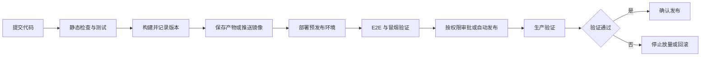

# 前端工程化：从开发到部署的自动化与标准化

> [!abstract] 核心观点
> 前端工程化通过自动化工具和标准化流程，提升开发效率、代码质量和可维护性。其核心目标是优化开发、构建、测试和部署流程，减少人工干预和重复劳动，便于项目扩展和团队协作。

谈工程化，很容易变成罗列工具：用了 ESLint、接了 Husky、引入了 Monorepo、写了 Dockerfile。但工具装齐了，不代表流程已经可靠。

更有用的判断方式是：新成员能不能按文档启动项目？一次修改能不能快速得到反馈？相同代码在不同环境里能不能得到预期产物？发布失败后能不能恢复？

这些问题把工程化串成一条主线：**把约定变成可执行规则，把重复动作交给工具，把关键决策保留给人。**

## 1. 用目标组织工程化，而不是用工具组织工程化

工程化的三个目标彼此关联，但不能互相替代。

| 目标 | 要解决的问题 | 对应的工程动作 |
| --- | --- | --- |
| 开发效率 | 配环境、执行命令、等待构建和反复排错占用时间 | 统一环境与脚本、快速反馈、任务并行与缓存 |
| 代码质量 | 错误依赖人工发现，修改后容易回归 | 静态检查、类型检查、分层测试、合并检查 |
| 可维护性 | 修改影响难判断，团队约定依赖口头传递 | 模块边界、依赖声明、配置复用、文档与版本追溯 |

自动化和标准化也需要配合。标准化先回答“什么算通过”，自动化再负责稳定执行。没有明确标准，流水线只是在更快地运行一组命令；只有标准而没有自动检查，又容易退回人工提醒。

围绕一次代码变更，可以划分四个环节：

| 环节 | 核心问题 | 应形成的结果 |
| --- | --- | --- |
| 开发 | 怎样让不同成员按相同约定工作？ | 环境、目录、依赖、命令和代码规则明确 |
| 构建 | 怎样稳定、高效地产生可交付产物？ | 输入与输出可追溯，任务关系与缓存正确 |
| 测试 | 怎样快速判断修改是否破坏既有行为？ | 风险有对应测试，失败有定位线索 |
| 部署 | 怎样把验证过的产物安全交给用户？ | 发布可重复、上线有验证、失败可恢复 |

这四个环节不是互相独立的配置清单。开发和 CI 应使用相同的检查入口，测试应尽量验证实际交付产物，部署应消费已生成的版本，而不是到服务器上临时重新构建。

## 2. 开发：让协作约定可执行，让反馈尽早发生

### 统一环境与命令入口

开发效率首先取决于项目能否稳定启动。

项目应明确 Node.js 和包管理器版本，提交 lockfile，并在启动流程或 CI 中校验版本。CI 使用 `pnpm install --frozen-lockfile` 等方式安装依赖，让依赖声明与锁文件不一致的问题尽早暴露。这能减少环境差异，但不等于仅靠 lockfile 就能保证产物逐字节一致。

日常操作通过 `package.json` scripts 暴露统一入口，例如：

```text
dev          启动开发环境
lint         执行代码规则检查
format:check 检查格式
typecheck    执行类型检查
test         执行自动化测试
build        生成生产产物
preview      预览静态构建产物，或使用对应的生产启动命令
```

脚本名称可以调整，关键是本地和 CI 调用相同入口，避免两套命令逐渐产生差异。README 说明如何启动与验证，贡献指南说明目录职责、依赖约束和提交要求。

### 用模块边界支持扩展，而不是为了工程化强行合库

只有一个应用时，可以先维护清楚的业务模块、公共组件和工具层。多个应用持续共享组件、类型或工具时，再考虑 Monorepo。

采用 Monorepo 后，可以用 `apps` 存放可部署应用，用 `packages` 存放共享能力，通过 pnpm workspace 管理包之间的依赖。但目录分开还不够，还要明确依赖方向：共享包不应反向依赖具体应用，应用也不应绕过包的公开入口随意引用内部文件。

每个包应声明自身直接使用的依赖，不能因为根目录安装了某个库，就默认所有子包都可以使用。需要宿主提供的 React 等运行时依赖，可以结合 `peerDependencies` 表达兼容要求。

**Monorepo 统一的是协作空间，不是强制统一所有运行时、版本和部署节奏。**

### 把代码规范接入日常反馈

不同检查工具负责不同问题：

| 工具 | 主要职责 | 不能替代什么 |
| --- | --- | --- |
| Prettier | 统一排版，减少格式争论 | 代码正确性检查 |
| ESLint | 检查代码规则和特定错误模式 | 完整类型检查与行为测试 |
| TypeScript | 检查类型关系和接口使用 | 运行时输入校验与业务测试 |
| CSpell | 检查命名、注释和文档中的拼写 | 业务含义判断 |
| Commitlint | 检查提交信息格式 | 代码评审与变更质量判断 |
| Husky | 在 Git Hook 中触发脚本 | CI 和服务端合并规则 |

ESLint 与 Prettier 应避免维护冲突的格式规则；CSpell 应维护合理词典，并排除生成目录。TypeScript 配置可以共享基础规则，再按浏览器、Node.js 和库构建的实际环境分别扩展。

编辑器提供即时提示，提交前主要执行变更文件的快速检查，`commit-msg` 检查提交信息。完整检查由 CI 兜底，并结合分支保护形成合并条件。

本地 Hook 可以被跳过，所以它适合改善反馈速度，不能承担最终保障。自动检查也不能代替人判断需求是否合理、抽象是否过度以及模块职责是否清楚。

## 3. 构建：先保证产物正确，再减少重复计算

### 明确构建输入、过程和产物

构建负责把源码转换为可运行、可分发的产物。Vite、Webpack 或框架内置构建工具，可以承担模块处理、代码转译、CSS 与资源处理以及产物优化等工作。

工具选型应服务于运行方式：静态站点生成静态文件，需要服务端执行的应用则还要生成服务端产物。独立发布的 TypeScript 库，可以按消费方需要使用 tsup 等工具生成模块产物和类型声明，不必让所有应用再套一层库构建流程。

还要区分转译和检查。构建工具能把 TypeScript 转成 JavaScript，不代表已经完成完整的类型检查；是否检查类型，应由独立任务或框架的明确行为保证。

构建应记录代码提交、依赖锁文件和相关配置，便于追踪“这个版本由什么生成”。

### 分清三种缓存

工程化中的缓存并不是同一件事：

- **依赖缓存**复用下载内容，减少重复下载；安装仍应遵循锁文件。
- **任务缓存**复用符合条件的检查结果或构建输出。
- **Docker 层缓存**复用未变化的镜像构建步骤。

多包项目中，pnpm workspace 负责包依赖，Turbo 负责任务编排和任务缓存。例如，下游应用构建前先完成其依赖库构建，互不依赖的任务可以并行。

缓存正确的前提是输入完整。源码、依赖、共享配置和影响结果的环境变量发生变化时，相应任务应失效。输出目录也需要声明，否则缓存命中不一定能恢复需要的文件。部署、通知等带有外部副作用的任务，不应直接按普通构建任务缓存。

### 同时关注构建速度和浏览器产物

构建优化不能只看 CI 少用了多少时间，还应检查用户最终下载和执行什么：

- 按使用路径拆分代码，避免把不需要的模块全部送到首屏。
- 检查重复依赖、大体积依赖和无效资源，结合产物分析定位原因。
- 按场景配置压缩、资源路径与 Source Map 的生成和访问方式。
- 为关键入口建立合理的产物体积预算，识别明显增长。

构建期配置与运行期配置也要分开。许多前端环境变量会在打包时写入 JavaScript，启动容器时更换环境变量，不会自动改写已经生成的文件。跨环境复用同一产物，需要设计运行时配置加载；否则应把环境配置明确纳入构建输入。任何送到浏览器的配置都不能作为秘密保存。

## 4. 测试：按风险分层，用自动验证减少重复回归

静态检查主要判断代码是否满足规则，测试进一步验证可观察行为。两者不能混为一谈。

前端测试可以按风险分层：

| 层次     | 重点验证        | 通用示例              |
| ------ | ----------- | ----------------- |
| 单元测试   | 独立逻辑与边界条件   | 格式转换、计算、校验、错误分支   |
| 组件测试   | 用户交互与界面状态   | 输入、提交、加载、禁用、错误提示  |
| 集成测试   | 多个模块连接后的行为  | 数据获取、状态更新与页面展示的配合 |
| E2E 测试 | 真实浏览器中的关键路径 | 从页面进入到一次核心操作完成    |
|        |             |                   |

Vitest、Jest、Testing Library、Playwright 等可以作为不同层次的实现选择，重点是每层验证什么，而不是必须把工具全部引入。

开发过程中运行快速、相关的测试；合并前执行必要的完整检查；在预发布环境针对待发布产物执行关键 E2E 和冒烟测试。少量关键 E2E 通常比大量不稳定的全链路脚本更有价值。

测试数据应隔离，外部依赖要可控，异步行为应等待明确状态而非任意休眠。失败时保留日志、截图或追踪信息，帮助定位原因。反复重试可以辅助诊断偶发失败，但不能把不稳定测试长期包装成通过。

覆盖率可以帮助发现遗漏，却不能证明断言有效。更重要的是：核心风险是否被验证，边界条件是否清楚，真实缺陷修复后是否补上了回归用例。

进一步的风险分层思路见 [[测试金字塔的核心思想和实践要点]]。

## 5. 部署：交付验证过的版本，而不是一串手工命令

### 根据运行方式选择部署方案

纯静态前端可以发布到对象存储、CDN 或静态服务器，不一定需要应用容器。需要 SSR 或其他服务端运行能力时，再考虑把运行环境与产物一起封装为镜像。

使用 Docker 时，多阶段构建把依赖安装、编译和运行阶段分开。最终镜像只保留必要的产物和运行依赖；通过 `.dockerignore` 排除本地依赖、无关文件与敏感配置，并尽量使用非 root 用户运行。

Dockerfile 中先复制依赖声明和锁文件、安装依赖，再复制经常变化的源码，有助于减少无谓的重复安装。这里要区分：**多阶段构建主要精简最终镜像，合理的层顺序主要改善构建缓存。**

单机场景可以通过 Compose 描述服务、网络、数据卷与健康检查，通过 Caddy 统一处理静态文件服务或反向代理、HTTPS 和入口配置。但 Compose 不会自动带来跨主机调度和无停机发布，这些能力仍需要对应的部署策略。

### 前端发布还要管理浏览器缓存

服务器更新成功，不代表用户已经拿到了完整、匹配的新版本。

带内容哈希的资源可以采用长期缓存；HTML 入口通常需要重新验证或采用较短缓存。发布时应先确保新资源可访问，再更新指向这些资源的入口，避免用户拿到新 HTML 却加载不到新文件。

旧资源也不宜立即删除：已经打开的旧页面，可能稍后才请求某个懒加载模块。保留合理的历史资源窗口，也有助于版本回退。

SPA 需要正确处理页面路由回退，但不能把缺失的 JavaScript 文件或 API 请求也统一回退成 HTML。否则表面返回成功，浏览器实际仍然无法执行。

### 用 CI/CD 串起验证、构建与发布

一条通用流程可以是：



流水线的价值是稳定执行相同规则，并留下可追溯结果。具体需要注意：

1. **产物可追溯**：记录提交号、产物校验值或镜像 digest，明确当前部署版本。
2. **尽量复用已验证产物**：部署阶段消费生成好的版本，避免在服务器上重新安装和构建。需要按环境构建时，也要验证对应产物。
3. **控制发布权限与并发**：凭据由平台管理，不向不可信任务暴露生产秘密，避免多个发布互相覆盖。
4. **上线后验证**：区分进程启动、服务就绪和用户路径可用，不能只看部署命令是否返回成功。
5. **提前准备恢复方式**：保留上一版产物、必要配置和历史资源；有条件时先验证新实例，再切换流量。

回滚也需要考虑浏览器缓存、客户端已加载代码与接口兼容性，不能只把服务器目录换回旧版。更复杂的平台发布策略应结合实际版本、灰度范围与回滚条件继续验证。

自动化不等于取消审批。风险较高的发布可以保留人工确认，但安装、检查、打包和传输这些重复动作不应依赖人工逐条执行。

## 6. 怎样落地，怎样判断是否值得

工程化应从当前反复消耗时间或容易出错的环节开始，而不是一次引入全部工具。

| 阶段         | 优先建设                      | 验收方式              |
| ---------- | ------------------------- | ----------------- |
| 先建立共同入口    | 环境版本、锁文件、启动文档、统一 scripts  | 新成员能按文档启动并运行检查    |
| 再把质量规则自动化  | 格式、Lint、类型检查、关键测试、CI 合并条件 | 本地与 CI 规则一致，失败能定位 |
| 再解决规模与速度问题 | 模块边界、配置复用、必要的多包管理与缓存      | 修改影响可判断，优化前后有对比   |
| 最后完善交付可靠性  | 产物版本、自动发布、上线验证、恢复流程       | 能确认运行版本，并演练失败恢复   |

各阶段可以交叉推进，但不应先追求复杂缓存或多包架构，再回头补最基本的启动文档和检查入口。

效果也不只看一个“构建提速比例”，可以分别观察：

- **效率**：首次启动耗时、开发修改到反馈的时间、冷构建与增量构建耗时、CI 排队与执行耗时。
- **质量**：回归缺陷、失败发布、测试不稳定比例、检查失败的定位成本。
- **可维护性**：重复配置、依赖边界违规、一次修改的影响范围、升级依赖所需协调成本。
- **交付可靠性**：发布操作数量、版本追溯能力、恢复耗时与恢复演练结果。

记录指标时要说明条件，例如机器、依赖缓存状态、变更规模和统计时间段。只比较一次热缓存构建和一次冷构建，无法说明整个工程体系更高效。

最终需要平衡收益和维护成本。一个快速、可信、团队愿意使用的流程，通常比规则繁多却经常被绕过的流程更有效。

## 7. 面试逐字稿

适用问题：你怎么理解前端工程化？如果从零搭建项目，你会怎么推进？

### 提取词

自动化与标准化｜效率、质量、可维护性｜开发统一约定｜构建稳定高效｜测试按风险分层｜部署可追溯可恢复｜按实际问题渐进建设

### 完整口述版本

工程化主要指的是在开发、构建、测试、部署阶段，通过自动化工具和标准化流程，减少重复操作，提升开发效率。

在我过去的开发经验中，我会在 package.json 中，明确 node 和包管理器的版本，统一项目运行的脚本入口，让成员能按相同方式启动项目。

代码层面使用 nx monorepo 限制模块依赖方向，底层变化速率较低的模块不需要每一次都参与进整体的构建流程中，而是直接复用缓存。

代码格式问题使用 Prettier，代码本身规则，如未使用变量等，则使用 ESLint 调整。两者冲突以 Prettier 为准。我的实践是，Prettier 可以设置对象最后一个属性要有逗号结尾，ESLint 设置 import 顺序，这样可以减少无用的 diff。

格式问题放在 CI 阶段的时间成本较高，我使用的是 husky + lint-staged 在本地提交代码前就对变更进行校验。CI 为了避免本地通过 `no-vertify` 绕过检测的场景做一次检查兜底。

测试我们要分两类去处理，一个是业务导向的自动化排查预期业务行为是否实现，比如填写合法信息后，提交能否成功，失败时能否保留输入，另一个是技术导向的组件实现是否正确，帮助我们定位具体的错误位置。如果只有前者，我们可以看到功能无法正常使用，但是无法定位具体的错误位置，就会进入我们的 debug 阶段。如果只有组件测试，它失败时，我们就无法确认影响到了具体的哪个业务表现

### 高频追问导航

- 为什么工程化不等于 Monorepo？见 [[#用模块边界支持扩展，而不是为了工程化强行合库|仓库选择与模块边界]]。
- 本地 Hook 和 CI 为什么都要做？见 [[#把代码规范接入日常反馈|检查分工与最终合并条件]]。
- pnpm、Turbo 和 Docker 的缓存有什么不同？见 [[#分清三种缓存|缓存对象与失效条件]]。
- 类型检查通过为什么还需要测试？见 [[#4. 测试：按风险分层，用自动验证减少重复回归|静态规则与行为验证]]。
- 前端工程化为什么不能只讲 Docker？见 [[#根据运行方式选择部署方案|静态交付与服务端交付]]。
- 服务器部署成功为什么页面仍可能报错？见 [[#前端发布还要管理浏览器缓存|资源发布顺序与版本匹配]]。
- 怎么证明工程化有效？见 [[#6. 怎样落地，怎样判断是否值得|分阶段验收与效果度量]]。

